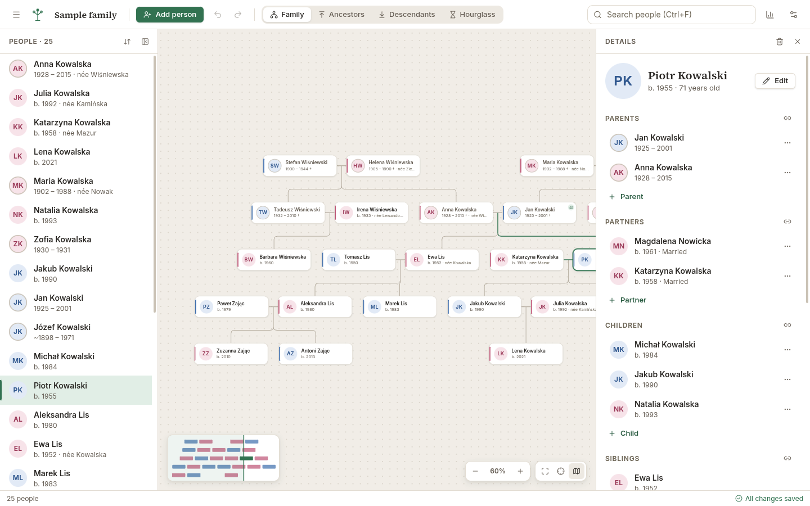
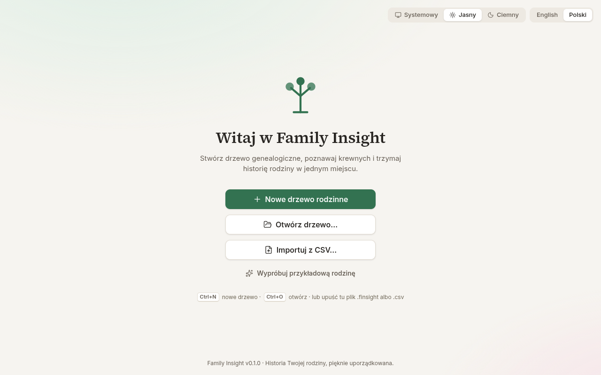
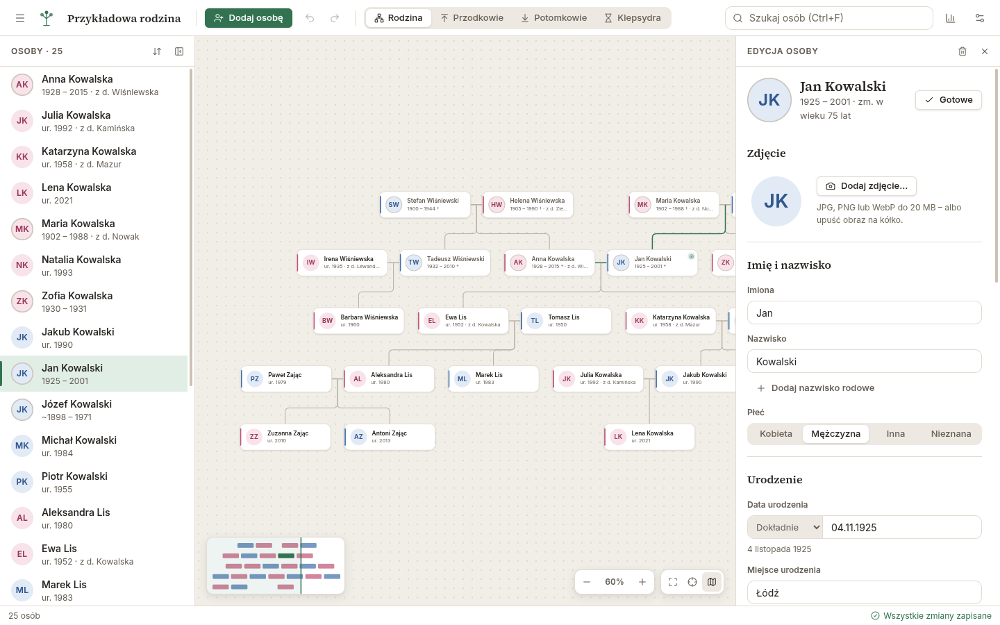
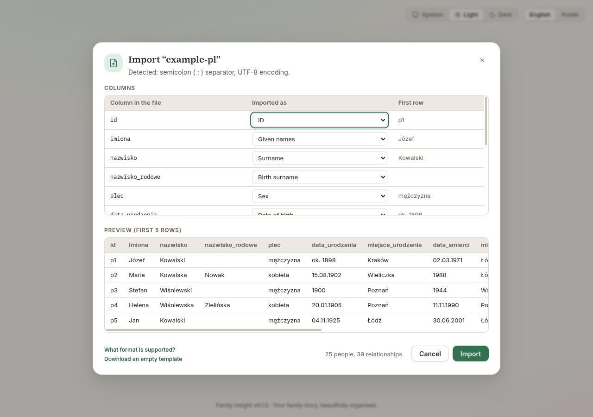
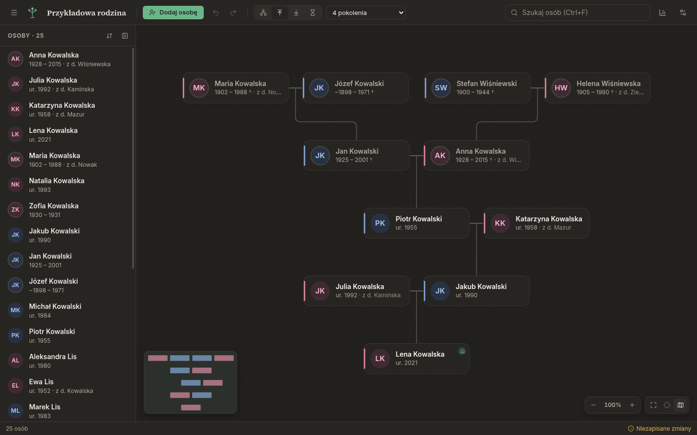

<div align="center">


# Family Insight

**A beautiful, simple family tree editor for Windows, macOS and Linux.**

English · [Polski](README.pl.md)

[**Download**](https://github.com/K-u-r-c/family-insight/releases/latest) ·
[User guide](docs/user-guide.en.md) ·
[CSV format](docs/developer/reference/csv-format.md)

<picture>
  <source media="(prefers-color-scheme: dark)" srcset="docs/images/hero-dark.png" />
  
</picture>

</div>

Family Insight helps you build your family tree, explore it comfortably and keep it up to date.
Everything stays on your computer in a single `.finsight` file — no account, no cloud, no ads.
CSV import and export let you work with Excel, LibreOffice or Google Sheets.

## Features

- **Interactive tree** – couples side by side, children under their parents, remarriages and
  half-siblings laid out clearly. Zoom, pan, minimap, fit to screen and keyboard navigation.
- **View modes** – the whole family, ancestors, descendants or an hourglass of one person,
  with a generation limit and collapsible branches.
- **Grow the tree in one click** – add a father, mother, partner, child or sibling straight from a
  person; link people who are already in the tree.
- **Real-life data** – partial and approximate dates (`~1890`, `before 1900`, `05.1890`), birth
  surnames, places with autocomplete, notes, portraits, adoptive/step/foster parents, marriages
  with dates and how they ended.
- **Life timeline and statistics** – each person's story at a glance; the most common names and
  places, and a to-do list of missing data.
- **Fast search** that ignores diacritics (`lodz` finds `Łódź`).
- **Safe by default** – undo/redo, autosave, crash recovery and rotating backups.
- **CSV import & export** – Excel-friendly (UTF-8 with BOM, `,` or `;`), English or Polish column
  names, a preview with clear error messages before anything is imported.
- **Print and export images** – PNG, SVG or PDF of the whole tree or the visible area.
- **English and Polish**, light and dark theme, accessible (keyboard, screen readers, WCAG AA).

<table>
  <tr>
    <td></td>
    <td></td>
  </tr>
  <tr>
    <td></td>
    <td></td>
  </tr>
</table>

## Download

Get the latest version from **[Releases](https://github.com/K-u-r-c/family-insight/releases/latest)**:

| System                | File                                                                |
| --------------------- | ------------------------------------------------------------------- |
| Windows 10/11         | `family-insight-<version>-setup.exe` (installer) or `-portable.exe` |
| macOS (Apple Silicon) | `family-insight-<version>-mac-arm64.dmg`                            |
| macOS (Intel)         | `family-insight-<version>-mac-x64.dmg`                              |
| Linux                 | `family-insight-<version>-linux-x86_64.AppImage` or `-amd64.deb`    |

The builds are not code-signed yet, so your system asks you to confirm the first launch:

- **Windows:** if SmartScreen appears, click _More info → Run anyway_.
- **macOS:** right-click the app in Applications and choose _Open_. If macOS says the app is
  damaged, run `xattr -cr "/Applications/Family Insight.app"` in Terminal once.
- **Linux:** the `.deb` package (`sudo apt install ./family-insight-*.deb`) adds a menu entry and
  opens `.finsight` files on double-click. The AppImage runs anywhere: `chmod +x family-insight-*.AppImage`
  and start it.

## FAQ

**Where is my data stored?** In the `.finsight` file you save — a readable JSON file. Back it up
like any document. Settings, recovery copies and the recent files list live in your user profile.

**Can I move my tree from another program?** Export it to CSV (or build a sheet with the
[documented columns](docs/developer/reference/csv-format.md)) and use _File → Import → CSV_. GEDCOM support is planned.

**Excel shows strange characters / everything in one column.** Export with the _semicolon_
separator (the default when the app is in Polish); the file includes a UTF-8 BOM so Polish
letters display correctly.

**Does it work offline?** Yes, completely. The app never sends your data anywhere.

## Development

Requirements: Node.js 24+ and npm.

```bash
npm install
npm run dev        # start the app with hot reload
npm run check      # typecheck + lint + format check + unit tests
npm run test:e2e   # end-to-end tests against the built app
npm run dist       # build installers for the current OS into dist/
```

| Script                                         | Description                                         |
| ---------------------------------------------- | --------------------------------------------------- |
| `npm run dev`                                  | Run in development mode                             |
| `npm run build`                                | Bundle main, preload and renderer into `out/`       |
| `npm test`                                     | Unit tests (Vitest)                                 |
| `npm run test:e2e`                             | End-to-end tests (Playwright driving the built app) |
| `npm run lint` / `npm run format`              | ESLint / Prettier                                   |
| `npm run icons`                                | Regenerate app icons from `build/icon.svg`          |
| `npm run dist:linux` / `dist:win` / `dist:mac` | Platform installers                                 |

Releases are built by GitHub Actions for all three platforms when a `v*` tag is pushed.

## Documentation

- [User guide](docs/user-guide.en.md) · [Podręcznik](docs/user-guide.pl.md)
- [Architecture](docs/developer/architecture.md)
- [CSV format](docs/developer/reference/csv-format.md)
- [`.finsight` file format](docs/developer/reference/file-format.md)
- [Translations](docs/developer/i18n.md)
- [Contributing](CONTRIBUTING.md) · [Changelog](CHANGELOG.md)

## Tech stack

Electron · React · TypeScript · Vite (electron-vite) · Zustand · i18next · Vitest · Playwright ·
electron-builder

## License

[MIT](LICENSE)
