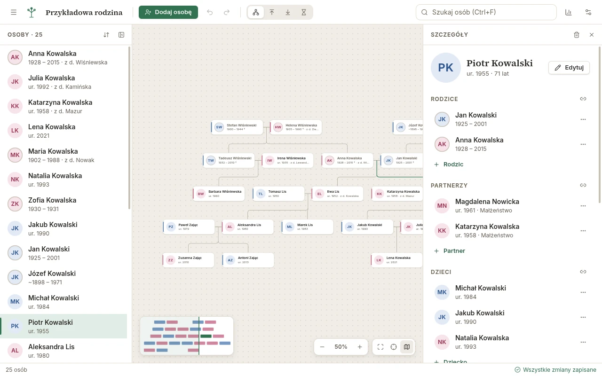

<div align="center">


# Family Insight

**Piękny i prosty program do tworzenia drzewa genealogicznego na Windows, macOS i Linux.**

[English](README.md) · Polski

[](https://github.com/K-u-r-c/family-insight/actions/workflows/ci.yml)
[](https://k-u-r-c.github.io/family-insight/)
[](https://github.com/K-u-r-c/family-insight/releases/latest)

[**Pobierz**](https://github.com/K-u-r-c/family-insight/releases/latest) ·
[**Poradnik**](https://k-u-r-c.github.io/family-insight/pl/guide/) ·
[Dla programistów](https://k-u-r-c.github.io/family-insight/developer/) (EN)

<picture>
  <source media="(prefers-color-scheme: dark)" srcset="docs/public/screenshots/pl/dark/workspace.webp" />
  
</picture>

</div>

Family Insight pomaga zbudować drzewo rodzinne, wygodnie je przeglądać i aktualizować.
Wszystko zostaje na Twoim komputerze w jednym pliku `.finsight` — bez konta, chmury i reklam.
Import i eksport CSV pozwala pracować z Excelem, LibreOffice lub Arkuszami Google.

## Funkcje

- **Interaktywne drzewo** – pary obok siebie, dzieci pod rodzicami, kolejne małżeństwa
  i przyrodnie rodzeństwo czytelnie rozmieszczone. Przybliżanie, przesuwanie, minimapa,
  dopasowanie do ekranu i nawigacja klawiaturą.
- **Tryby widoku** – cała rodzina, przodkowie, potomkowie albo „klepsydra” wybranej osoby,
  z limitem pokoleń i zwijanymi gałęziami.
- **Drzewo rośnie jednym kliknięciem** – dodaj ojca, matkę, partnera, dziecko lub rodzeństwo
  prosto z karty osoby; połącz osoby, które już są w drzewie.
- **Prawdziwe dane** – niepełne i przybliżone daty (`ok. 1890`, `przed 1900`, `05.1890`),
  nazwiska rodowe, miejsca z podpowiedziami, notatki, zdjęcia, rodzice adopcyjni, przybrani
  i zastępczy, małżeństwa z datami i sposobem zakończenia.
- **Oś życia i statystyki** – historia każdej osoby w jednym miejscu; najczęstsze imiona
  i miejsca oraz lista brakujących danych.
- **Szybkie wyszukiwanie** ignorujące polskie znaki (`lodz` znajdzie `Łódź`).
- **Bezpieczeństwo** – cofnij/ponów, autozapis, odzyskiwanie po awarii i kopie zapasowe.
- **Import i eksport CSV** – przyjazny dla Excela (UTF-8 z BOM, `,` lub `;`), polskie
  lub angielskie nazwy kolumn, podgląd z czytelnymi błędami przed importem.
- **Druk i eksport obrazów** – PNG, SVG lub PDF całego drzewa lub widocznego fragmentu.
- **Polski i angielski**, jasny i ciemny motyw, dostępność (klawiatura, czytniki ekranu, WCAG AA).

## Pobieranie

Najnowsza wersja: **[Releases](https://github.com/K-u-r-c/family-insight/releases/latest)**.

| System                | Plik                                                                 |
| --------------------- | -------------------------------------------------------------------- |
| Windows 10/11         | `family-insight-<wersja>-setup.exe` (instalator) lub `-portable.exe` |
| macOS (Apple Silicon) | `family-insight-<wersja>-mac-arm64.dmg`                              |
| macOS (Intel)         | `family-insight-<wersja>-mac-x64.dmg`                                |
| Linux                 | `family-insight-<wersja>-linux-x86_64.AppImage` lub `-amd64.deb`     |

Wersje nie są jeszcze podpisane cyfrowo, dlatego system poprosi o potwierdzenie pierwszego uruchomienia:

- **Windows:** jeśli pojawi się SmartScreen, kliknij _Więcej informacji → Uruchom mimo to_.
- **macOS:** kliknij aplikację w Aplikacjach prawym przyciskiem i wybierz _Otwórz_. Jeśli macOS
  twierdzi, że aplikacja jest uszkodzona, uruchom raz w Terminalu
  `xattr -cr "/Applications/Family Insight.app"`.
- **Linux:** pakiet `.deb` (`sudo apt install ./family-insight-*.deb`) dodaje skrót w menu i otwiera
  pliki `.finsight` dwuklikiem. AppImage działa wszędzie: `chmod +x family-insight-*.AppImage` i uruchom.

## Najczęstsze pytania

**Gdzie są moje dane?** W zapisanym pliku `.finsight` (czytelny plik JSON). Rób jego kopie jak
każdego dokumentu. Ustawienia, kopie odzyskiwania i lista ostatnich plików są w profilu użytkownika.

**Czy mogę przenieść drzewo z innego programu?** Wyeksportuj je do CSV (albo przygotuj arkusz
z [opisanymi kolumnami](https://k-u-r-c.github.io/family-insight/pl/guide/csv-import)) i użyj _Plik → Importuj → CSV_. Obsługa GEDCOM jest planowana.

**Excel pokazuje dziwne znaki / wszystko w jednej kolumnie.** Eksportuj z separatorem _średnik_
(domyślnym, gdy aplikacja jest po polsku); plik ma znacznik UTF-8 BOM, więc polskie litery
wyświetlają się poprawnie.

**Czy działa bez internetu?** Tak, w pełni. Aplikacja nigdzie nie wysyła Twoich danych; opcjonalne
wyszukiwanie miejsc (domyślnie wyłączone) wysyła do OpenStreetMap tylko nazwę miejsca, gdy o to
poprosisz.

## Rozwój

Wymagania: Node.js 24+ i npm.

```bash
npm install
npm run dev        # uruchom aplikację z hot reload
npm run check      # typecheck + lint + formatowanie + testy jednostkowe
npm run test:e2e   # testy end-to-end na zbudowanej aplikacji
npm run dist       # zbuduj instalatory dla bieżącego systemu do dist/
```

Wydania dla wszystkich trzech systemów buduje GitHub Actions po wypchnięciu tagu `v*`.

## Dokumentacja

Wszystko znajdziesz na **[stronie dokumentacji](https://k-u-r-c.github.io/family-insight/pl/)**:

- [Poradnik](https://k-u-r-c.github.io/family-insight/pl/guide/) ·
  [User guide (EN)](https://k-u-r-c.github.io/family-insight/guide/) – instalacja, samouczki,
  import i eksport CSV, najczęstsze pytania i rozwiązywanie problemów
- [Dokumentacja dla programistów](https://k-u-r-c.github.io/family-insight/developer/) (EN) –
  uruchomienie projektu, architektura, poradniki, formaty CSV i `.finsight`
- [Jak współtworzyć](CONTRIBUTING.md) (EN) · [Lista zmian](CHANGELOG.md)

## Licencja

[MIT](LICENSE)
