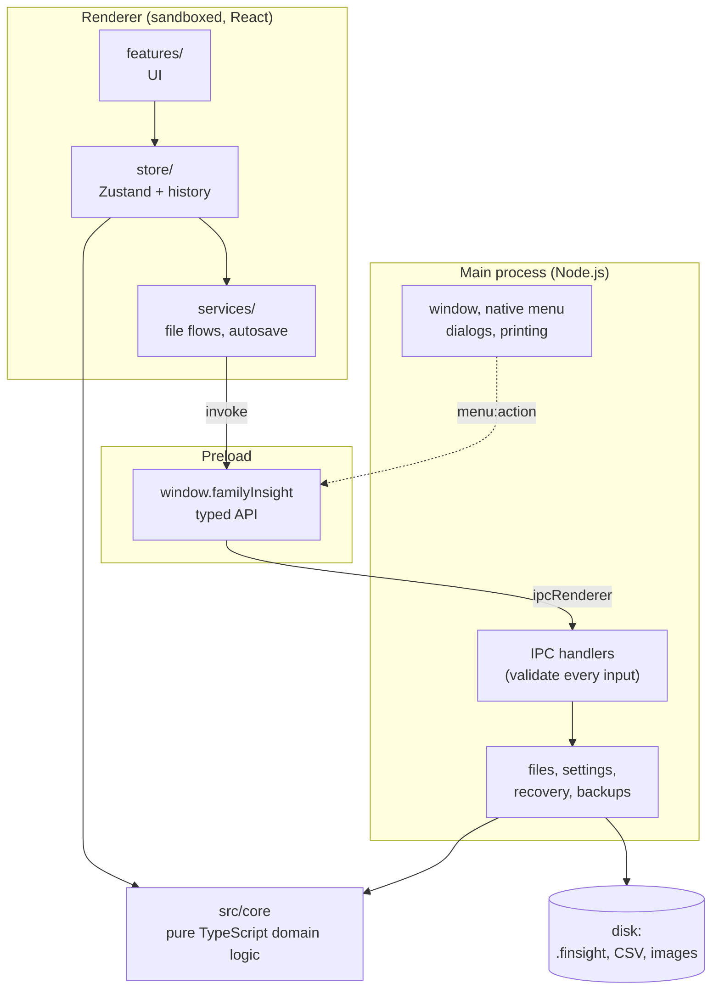
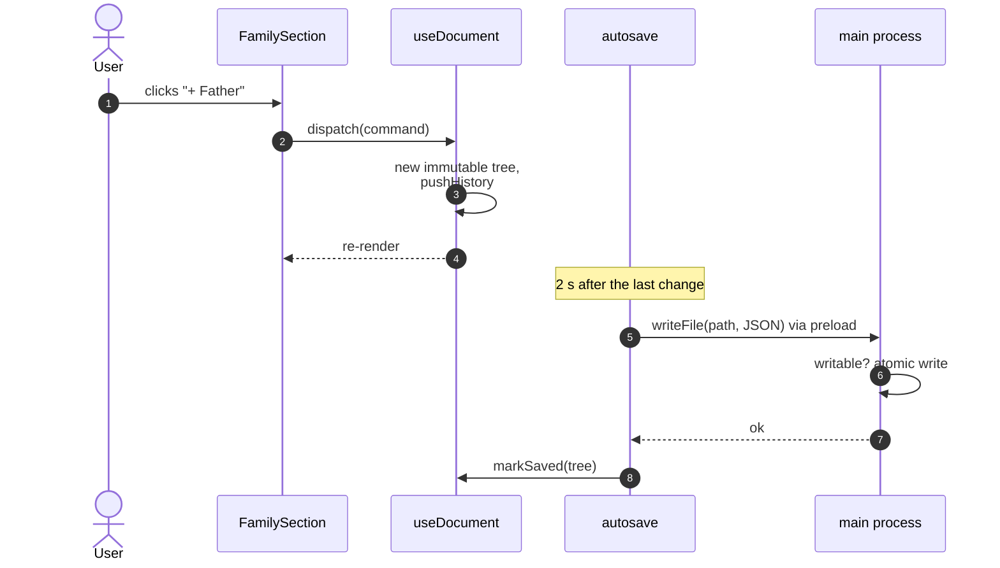

# Architecture overview

Family Insight is an Electron app with three processes and a strict separation between pure domain
logic and everything that touches the operating system or the screen.

## Layers

| Layer        | Folder             | May use                                      | Never                           |
| ------------ | ------------------ | -------------------------------------------- | ------------------------------- |
| Domain       | `src/core`         | plain TypeScript                             | Electron, React, DOM, Node APIs |
| Shared       | `src/shared`       | core types                                   | process-specific APIs           |
| Main process | `src/main`         | Node, Electron, core, shared                 | React                           |
| Preload      | `src/preload`      | `contextBridge`, `ipcRenderer`, shared types | business logic                  |
| Renderer     | `src/renderer/src` | React, core, shared, `window.familyInsight`  | Node, `fs`, Electron            |

The domain layer – the model, dates, CSV, layout, history, search and statistics – is where most
logic lives. It is pure and synchronous, so it is easy to test and reuse: the same CSV importer runs
in the renderer for the preview and could run anywhere else.

## Principles

1. **Domain logic lives in `src/core`** and is unit-tested with Vitest. The UI and the main process
   are thin layers on top. New capabilities such as GEDCOM are new modules in `core/io`, not
   rewrites.
2. **Security first:** context isolation, sandbox, a strict content security policy and a small,
   typed IPC surface whose inputs are validated in main. See [Security model](./security).
3. **One IPC contract:** channel names and the `FamilyInsightApi` type are declared once in
   `src/shared/ipc.ts` and implemented in `src/main/ipc.ts` and `src/preload/index.ts`.
4. **Every string is translated:** i18next resources in `src/shared/locales/{en,pl}.json`, used by
   the renderer and the native menu. See [Internationalisation](./i18n).
5. **Every colour is a token:** components use the CSS variables from
   `src/renderer/src/styles/tokens.css`, so light, dark and “follow system” work everywhere.
6. **Every edit is a command:** document changes go through commands and an immutable history, so
   undo/redo, autosave and recovery work uniformly. See [State, undo and saving](./state).
7. **Extension points:** the import/export format registry, view modes and locales. See the
   [how-to guides](./howto/format).

## From a click to the disk

What happens when the user adds a father in the details panel:

- Commands are pure functions `tree → tree` built on `src/core/model/operations.ts`; a model error
  (for example a cycle) throws and is shown as a toast, leaving the tree untouched.
- The tree is immutable: unchanged people and relationships are shared between versions, which keeps
  undo snapshots cheap.
- Saving serialises the tree with `serializeTree` (`src/core/file`) and writes it atomically in main.

## Further reading

- [Security model](./security) – process isolation, the preload API and file access rules
- [Domain model](./domain-model) – people, relationships and dates
- [State, undo and saving](./state) – stores, commands, history, autosave and recovery
- [Tree layout engine](./layout) and [Rendering the tree](./rendering)
- [Packaging](./packaging) – installers, icons and file associations
- [Decision log](./reference/decisions) – why things are the way they are
