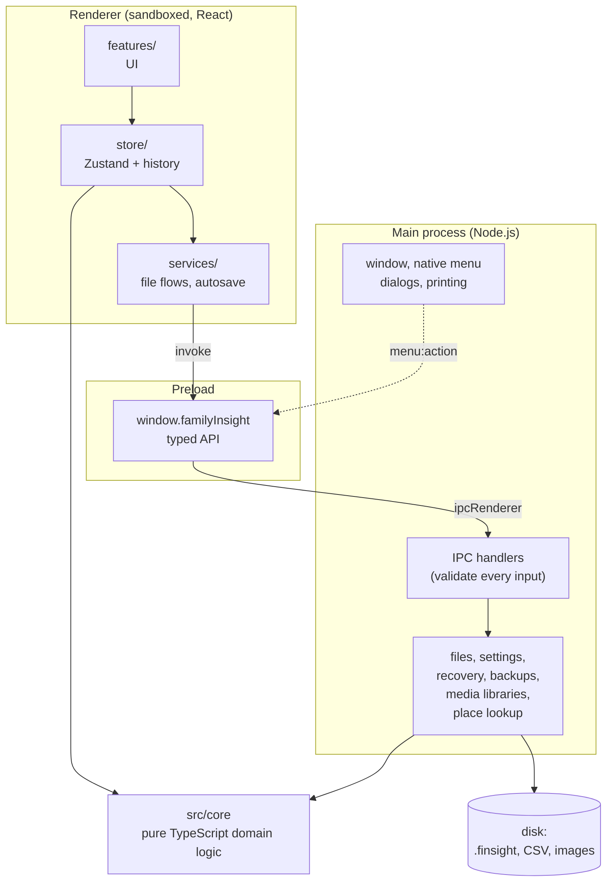
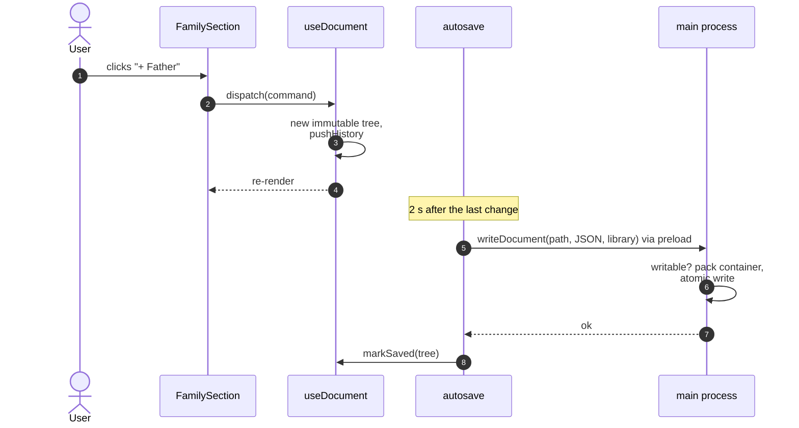
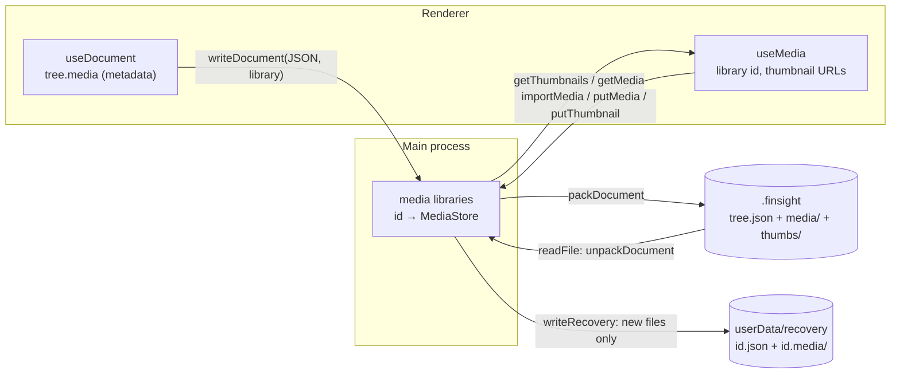

# Architecture overview

Family Insight is an Electron app with three processes and a strict separation between pure domain
logic and everything that touches the operating system or the screen.

## Layers

| Layer        | Folder             | May use                                      | Never                           |
| ------------ | ------------------ | -------------------------------------------- | ------------------------------- |
| Domain       | `src/core`         | plain TypeScript                             | Electron, React, DOM, Node APIs |
| Shared       | `src/shared`       | core types                                   | process-specific APIs           |
| Main process | `src/main`         | Node, Electron, core, shared                 | React                           |
| Preload      | `src/preload`      | `contextBridge`, `ipcRenderer`, shared types | business logic                  |
| Renderer     | `src/renderer/src` | React, core, shared, `window.familyInsight`  | Node, `fs`, Electron            |

The domain layer – the model, dates, CSV, layout, history, search and statistics – is where most
logic lives. It is pure and synchronous, so it is easy to test and reuse: the same CSV importer runs
in the renderer for the preview and could run anywhere else.

## Principles

1. **Domain logic lives in `src/core`** and is unit-tested with Vitest. The UI and the main process
   are thin layers on top. New capabilities such as GEDCOM are new modules in `core/io`, not
   rewrites.
2. **Security first:** context isolation, sandbox, a strict content security policy and a small,
   typed IPC surface whose inputs are validated in main. See [Security model](./security).
3. **One IPC contract:** channel names and the `FamilyInsightApi` type are declared once in
   `src/shared/ipc.ts` and implemented in `src/main/ipc.ts` and `src/preload/index.ts`.
4. **Every string is translated:** i18next resources in `src/shared/locales/*.json`, used by
   the renderer and the native menu. See [Internationalisation](./i18n).
5. **Every colour is a token:** components use the CSS variables from
   `src/renderer/src/styles/tokens.css`, so light, dark and “follow system” work everywhere.
6. **Every edit is a command:** document changes go through commands and an immutable history, so
   undo/redo, autosave and recovery work uniformly. See [State, undo and saving](./state).
7. **Extension points:** the import/export format registry, view modes and locales. See the
   [how-to guides](./howto/format).

## From a click to the disk

What happens when the user adds a father in the details panel:

- Commands are pure functions `tree → tree` built on `src/core/model/operations.ts`; a model error
  (for example a cycle) throws and is shown as a toast, leaving the tree untouched.
- The tree is immutable: unchanged people and relationships are shared between versions, which keeps
  undo snapshots cheap.
- Saving serialises the tree with `serializeTree` (`src/core/file`); main packs the JSON with the
  document's media into the `.finsight` container and writes it atomically.

## Media library {#media-library}

Photos and scanned documents are not part of the JSON. The document lists them as `media` items
(id, SHA-256 `hash`, type, file name, title …); their bytes live in a **media library** – a
`MediaStore` (`src/core/file/container.ts`) of `hash → bytes` plus thumbnails – held by the main
process for each open document and addressed by an id:

- **Saving sends only JSON** over IPC. Main includes the media the JSON lists – everything else is
  garbage-collected from the file, never from the library, because undo may bring an item back.
  Unchanged media keep their CRC, so saving a large tree costs little more than writing it.
- Reading a `.finsight` file creates a library (`FileReadResult.library`); new trees get one on first
  use (`ensureLibrary` in `services/media.ts`) and a library is released when another document
  opens.
- **Thumbnails** (WebP, 256 px) are made in the renderer with `createImageBitmap` and a canvas – it
  decodes every supported image type and works on any platform – and stored in the container, so the
  tree view never decodes full scans. PDFs have no thumbnail.
- **The gallery UI** lives in `src/renderer/src/features/media/`: `GallerySection` (person details),
  `MediaViewer` (zoom/pan, previous/next; PDFs in Chromium's built-in viewer inside an `<iframe>`
  of a `blob:` URL, allowed by `frame-src blob:` in the CSP), `MediaDetailsDialog` (title, date,
  place, description, the people it is shown on) and `MediaStrip` (scans of sources and citations).
  The viewer and the details dialog are opened through the workspace UI store (`viewMedia`,
  `setEditingMedia`), so any component can open them. Full-size files are fetched on demand and a
  dozen object URLs are kept (`fullMediaUrl`).
- Exported images embed portrait thumbnails as data URLs (`portraitDataUrl`), because the SVG is
  rendered where the renderer's object URLs don't exist.
- **Crash recovery** writes each media file once to `userData/recovery/<id>.media/<hash>` next to the
  JSON snapshot; restoring loads them into a new library.
- The container code, hashing (`@noble/hashes`) and media model are pure TypeScript in `src/core`, so
  a platform without a main process can host the library itself.

## Places, the map and the network

People's places are free text; coordinates come from the tree's gazetteer (`tree.places`,
`src/core/model/places.ts`). The map view (`features/map`, lazily loaded Leaflet) draws markers
from `src/core/mapData.ts`. The renderer never talks to the internet; the two opt-in online
features go through main:

- **Place lookup** – `lookupPlace` → main checks `onlinePlaceLookup` and queries OpenStreetMap
  Nominatim through a rate-limited, caching `Geocoder` (`src/main/geocoder.ts`).
- **Updates** – main checks the latest release once a day (`src/main/updater.ts`): electron-updater
  for builds that can install updates (Windows installer, AppImage), the GitHub releases API for
  the others; policy helpers in `src/core/updates.ts`.
- **Map tiles** – Leaflet loads `fi-tile://map/{z}/{x}/{y}.png`; main's protocol handler
  (`src/main/tiles.ts`) checks `onlineMaps` and fetches and caches the tile (`TileService`).

See the decision log entries for [places](./reference/decisions#places-gazetteer-and-opt-in-lookup-2026-10-issue-58)
and the [map](./reference/decisions#map-view-leaflet-with-tiles-through-the-main-process-2026-10-issue-59).

## Further reading

- [Security model](./security) – process isolation, the preload API and file access rules
- [Domain model](./domain-model) – people, relationships and dates
- [State, undo and saving](./state) – stores, commands, history, autosave and recovery
- [Tree layout engine](./layout) and [Rendering the tree](./rendering)
- [Packaging](./packaging) – installers, icons and file associations
- [Decision log](./reference/decisions) – why things are the way they are
