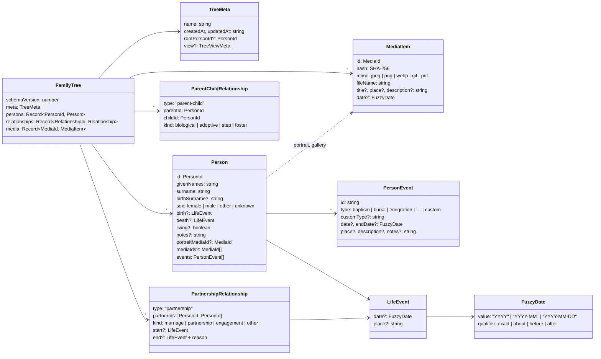

# Domain model

A family is modelled as a **graph**, not a strict tree: people are nodes and relationships are
edges. That's what lets Family Insight represent remarriages, half-siblings, adoption and people
who aren't connected to anyone yet. All types are in `src/core/model/types.ts`.

## People

- `givenNames` and `surname` are plain strings (possibly empty while a new person is being named);
  `displayName()` joins them.
- `living` is `true`, `false` or **absent for “unknown”**. `isLiving()` infers `false` when there is a
  death date or place.
- `portraitMediaId` points to a media item – the portrait cropped to 512 × 512 (WebP, or JPEG where
  WebP encoding isn't available). Media items describe photos and documents; their bytes are stored
  once per SHA-256 hash in the `.finsight` container, outside the JSON (`src/core/model/media.ts`,
  see [the media library](./architecture#media-library)). Before schema 3 the portrait was a
  `photo` data URL.
- Ids are opaque strings (`crypto.randomUUID()`), never shown to users. CSV export assigns
  readable ids `p1`, `p2` … instead.

### Life events

`events` holds further facts – baptism, emigration, military service, occupation … (`EVENT_TYPES`),
or a `custom` event with its own name. `date` and `endDate` describe a period. They are edited with
`addPersonEvent`, `updatePersonEvent`, `removePersonEvent` and `movePersonEvent` (not through
`updatePerson`), appear in the timeline (`buildTimeline`; burial and cremation after death), are
searchable, and get plausibility warnings (event before birth, after death, end before start).
Birth and death remain separate fields because the layout, ages and statistics rely on them.

### Sources and citations

The tree holds `sources` and `repositories`; a **citation** (`{ sourceId, page, quality, date, text,
notes }`) is stored next to the fact it supports – the person, birth, death, a life event, a
relationship, or a partnership's start/end. `src/core/model/sources.ts` addresses facts with a
`CitationTarget` and provides `addCitation` / `updateCitation` / `removeCitation`, source and
repository operations (deleting a source removes its citations; deleting a repository unlinks its
sources), and queries: `getCitationsForSource`, `factsWithoutSource`, `sourcesOfPerson`. Search
includes the titles of a person's sources.

## Relationships

There are two kinds of edges:

- **Parent–child** (`parentId` → `childId`) with a `kind`. Siblings are not stored: they are derived
  from shared parents (`getSiblings`, `getSiblingGroups` splits full and half siblings).
- **Partnership** between two people with a `kind`, optional start and end events and an end
  `reason` (`divorce`, `separation`, `death`, `other`).

### Invariants

`src/core/model/operations.ts` enforces them and throws a `ModelError` with a stable code that the UI
translates (`errors.model.<code>`):

| Code                                         | Rule                                                           |
| -------------------------------------------- | -------------------------------------------------------------- |
| `self-relationship`                          | Nobody can be their own parent or partner.                     |
| `duplicate-relationship`                     | The same parent link or partnership can't exist twice.         |
| `ancestry-cycle`                             | A child can't already be an ancestor of the new parent.        |
| `too-many-biological-parents`                | At most two **biological** parents; other kinds are unlimited. |
| `person-not-found`, `relationship-not-found` | References must exist.                                         |
| `duplicate-id`                               | Merging trees can't reuse ids.                                 |

`validateTree` (`src/core/model/validate.ts`) checks a whole tree – used after loading a file and after
a CSV import – and reports problems such as cycles or dangling references as issues instead of
throwing.

## Operations and queries

All operations are **pure**: they take a tree and return a new one, sharing unchanged parts
(`addPerson`, `updatePerson`, `removePerson`, `addParentChild`, `addPartnership`,
`updateRelationship`, `removeRelationship`, `setRootPerson`, `renameTree`, `mergeTrees`). Removing a
person also removes their relationships; if they were the root person, the root moves to a
partner, child or parent (or anyone else), so the views keep working.

Queries live in `src/core/model/tree.ts`: `getParents`, `getChildren`, `getPartners`, `getSiblings`,
`getAncestors(depth)`, `getDescendants(depth)`, `getPartnershipBetween` and more.

## Fuzzy dates

`src/core/date/fuzzyDate.ts` implements genealogical dates:

- `parseFuzzyDate(text)` accepts ISO prefixes (`1890`, `1890-05`, `1890-05-12`), day-first forms
  (`12.05.1890`, `05.1890`, `12/05/1890`) and qualifier prefixes in English and Polish (`~`, `abt`,
  `ok.`, `<`, `bef`, `przed`, `>`, `aft`, `po`); it returns `null` for invalid input.
- `formatFuzzyDate(date, language)` produces “about May 1890” or “ok. maja 1890” – with the correct
  Polish grammatical case for each qualifier.
- `compareFuzzyDates` sorts chronologically, `ageAt` computes completed years and whether the result
  is approximate.
- `src/core/date/plausibility.ts` produces the soft warnings (death before birth, older than 120,
  parent not older than child).

## Persistence

`serializeTree` / `parseTree` in `src/core/file/format.ts` read and write the
[`.finsight` format](./reference/file-format): JSON with a `schemaVersion`, checked by
`checkTreeShape` and upgraded by `migrate` (`migrations.ts`). See
[Add a field to a person](./howto/person-field) for how the schema evolves.
