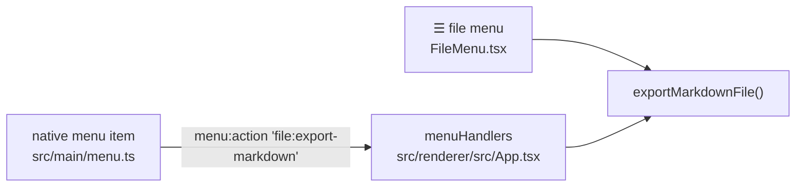

# Add a menu item or shortcut

Commands appear in up to three places: the **native menu bar** (built in main), the **in-window
menus** (☰ file menu, card menu – React) and **keyboard shortcuts**. They all end in the same handler
in the renderer.



## 1. Name the action

Add it to the `MenuAction` union in `src/shared/ipc.ts`:

```ts
export type MenuAction =
  | 'file:new'
  // …
  | 'file:export-markdown'
```

## 2. Native menu – `src/main/menu.ts`

Inside `buildMenu()`, add an item with the `item(id, label, action, accelerator?)` helper:

```ts
{
  label: t('menu.export'),
  submenu: [
    item('export-csv', t('menu.exportCsvShort'), 'file:export-csv'),
    item('export-image', t('menu.exportImageShort'), 'file:export-image'),
    item('export-markdown', t('menu.exportMarkdownShort'), 'file:export-markdown')
  ]
}
```

- Accelerators use Electron syntax: `'CmdOrCtrl+Shift+M'`.
- If the command needs an open tree, add its id to `DOCUMENT_ITEMS` so it is disabled on the welcome
  screen. Items depending on undo, selection or the view mode are updated in `applyState()`.
- The menu is rebuilt when the language changes, so labels must come from `t()`.

## 3. Handle it – `src/renderer/src/App.tsx`

```ts
const menuHandlers = useMemo(
  () => ({
    // …
    'file:export-markdown': () => {
      if (useDocument.getState().tree) void exportMarkdownFile()
    }
  }),
  []
)
```

`useMenuIntegration` routes the action to the handler. It also keeps native undo/redo working on text
while a text field has the focus.

## 4. In-window menus

Add the same command to `src/renderer/src/features/workspace/FileMenu.tsx` (the ☰ menu) – entries
have a `label`, an optional `shortcut` (`formatShortcut('Mod+Shift+M')`) and `onSelect`. The card's
right-click menu is built in the `onContextMenu` callback in `TreeCanvas.tsx`.

## 5. Keyboard shortcuts

- A shortcut that belongs to a menu item is just its **accelerator**.
- Shortcuts without a menu item go to `src/renderer/src/hooks/useGlobalShortcuts.ts` (app-wide, ignoring
  text fields where needed) or to the canvas `onKeyDown` in `TreeCanvas.tsx` (tree only).
- Add it to `SHORTCUT_GROUPS` in `src/shared/shortcuts.ts` – the in-app cheat sheet and the
  [shortcuts page](/guide/shortcuts) of the guide are rendered from it.
- Don't reuse a shortcut the system or Chromium uses (`Ctrl+R`, `Ctrl+Q`, `Cmd+H` …).

## 6. Text and tests

Add the labels to both locale files. Native accelerators can't be pressed by Playwright – in E2E tests
trigger the action like the menu does:

```ts
await app.evaluate(({ BrowserWindow }) => {
  BrowserWindow.getAllWindows()[0]!.webContents.send('menu:action', 'file:export-markdown')
})
```
