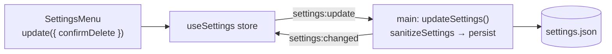

# Add a setting

Settings are one JSON file (`settings.json` in the user data folder) owned by the main process. The
renderer reads a copy and sends changes over IPC. This example adds a `confirmDelete` switch
(“Ask before deleting a person”); the core steps were compiled and tested while writing this page.



## 1. Schema, default and validation – `src/core/settings.ts`

```ts
export interface Settings {
  // …
  backups: boolean
  /** Ask before deleting a person. */
  confirmDelete: boolean
  panels: PanelSettings
}

export function defaultSettings(language: string): Settings {
  return {
    // …
    backups: true,
    confirmDelete: true
    // …
  }
}
```

In `sanitizeSettings`, accept only valid values – everything else keeps the fallback, so old or
damaged settings files and bad IPC patches can't break the app:

```ts
if (typeof src.confirmDelete === 'boolean') out.confirmDelete = src.confirmDelete
```

Add a case to `src/core/settings.test.ts` (valid value kept, invalid value ignored, missing value
defaults).

## 2. Persistence – nothing to do

`src/main/settings.ts` loads, sanitises and saves the whole object, and broadcasts
`settings:changed` to the renderer after every update. Old settings files simply get the default.

## 3. Use it in the renderer

```ts
const confirmDelete = useSettings((s) => s.settings.confirmDelete)
```

and change it with `useSettings.getState().update({ confirmDelete: false })`.

## 4. Show it in the UI

Add an entry to the gear menu in `src/renderer/src/features/workspace/SettingsMenu.tsx`:

```ts
{
  label: t('settings.confirmDelete'),
  checked: settings.confirmDelete,
  onSelect: () => void update({ confirmDelete: !settings.confirmDelete })
}
```

If it belongs in the native menu too, add a checkbox item in `buildMenu()` (`src/main/menu.ts`) that
calls `updateSettings({ confirmDelete: … })`, like **Overview map** does. Add the labels to both
locale files and document the setting in the [user guide](/guide/settings).
