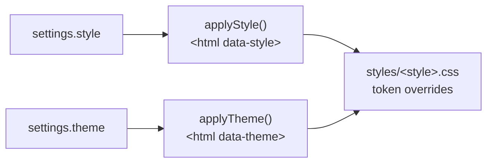

# Add a visual style

A **style** changes the look of the whole app: colours, fonts, corner radii, shadows and the type
scale. Theme (light/dark/system) and style are independent, so every style has a light and a dark
variant. The default style is **Modern**; **Tapestry** (old family tapestry: parchment and ink,
dark green and gold) was added the way this page describes.

## 1. The setting value – `src/core/settings.ts`

Add the name to `AppStyle` and `APP_STYLES`. `sanitizeSettings` accepts only the listed names and
falls back to `modern`, so old settings files and bad IPC patches are safe. Add a case to
`settings.test.ts`.

## 2. Tokens – `src/renderer/src/styles/<style>.css`

Copy `tapestry.css` as a template and import the new file in `src/renderer/src/main.tsx` **after**
`tokens.css`. It has three blocks with the same selectors as the theme blocks in `tokens.css`, one
level more specific:

| Block              | Selector                                                                                |
| ------------------ | --------------------------------------------------------------------------------------- |
| light              | `:root[data-style='<style>']`                                                           |
| dark (chosen)      | `:root[data-style='<style>'][data-theme='dark']`                                        |
| dark (system mode) | `@media (prefers-color-scheme: dark)` + `:root[data-style='<style>']:not([data-theme])` |

Override **every** colour token of `tokens.css` in the light block and in both dark blocks (the dark
blocks are duplicated on purpose, as in `tokens.css`). Check text/background pairs for WCAG AA
(≥ 4.5:1) before you commit: `e2e/a11y.spec.ts` runs axe in every style and theme.

Fonts: bundle them from Fontsource (`@fontsource-variable/`, imported at the top of the style
file) – never from the network. They must have an open licence (OFL), **Latin Extended and
Cyrillic** (the app speaks Polish and Russian), and be added to `THIRD_PARTY_NOTICES.md` and the
`extraResources` licence list in `electron-builder.yml`.

## 3. Menus and texts

The gear menu (`SettingsMenu.tsx`) and **View → Style** (`src/main/menu.ts`, item ids
`style-<name>`) list `APP_STYLES` automatically. Add `style.<name>` to **every** locale file.

## 4. Components

Components must keep using tokens only – no raw colours or fonts – so a new style works everywhere.
When a component needs a style-specific shape (for example a card frame), prefer a token
(`--radius-*`, `--shadow-*`) or a `:root[data-style='<style>'] .class` rule in the component's CSS
module over JavaScript branches.

## 5. Tests and docs

- `e2e/styles.spec.ts` switches styles from both menus; add the new style to the a11y loop in
  `e2e/a11y.spec.ts`.
- Inspect offscreen screenshots in light and dark, in English, Polish and Russian.
- Mention the style in the user guide's settings page in every language.
