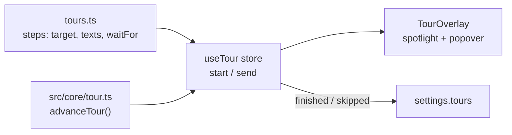

# Add a guided tour or a step

A **guided tour** dims the window around one element after another and explains it in a popover
(**Back / Next / Skip**, <kbd>Esc</kbd> skips, <kbd>←</kbd>/<kbd>→</kbd> move). The dimming is visual
only – the app stays usable – so a step can ask the user to do something and advance by itself.



## 1. Mark the target

Give the element a `data-tour` attribute (UI components pass it through):

```tsx
<Button data-tour="add-person" …>
```

A step whose target is not on screen (hidden panel, narrow window) is shown centred, so a tour never
gets stuck. Avoid targets inside **modal dialogs**: native modals sit in the browser's top layer,
above the overlay.

## 2. Add the step – `src/renderer/src/features/tour/tours.ts`

```ts
step('parent', 'add-parent', (c) => c.parentLinks > 0 && !c.editing)
// → { id, target, title: 'tour.firstRun.parent.title', body: 'tour.firstRun.parent.body', waitFor }
```

`waitFor` receives a `TourContext` (`tourContext()` – people, selection, editing, parent links);
the overlay checks it every 200 ms and moves on when it holds – also for steps that are already
done when the tour reaches them, so a tour adapts to the user's tree. After **Back** a step waits
for **Next**. Extend `TourContext` when a step needs more. A new tour is a new key in `TOURS`.

## 3. Texts

Add the title and text keys under `tour.<tour>.<step>` to **every** locale file – short and
friendly, one or two sentences.

## 4. Start it

`useTour.getState().start('<tour>')`. The welcome screen offers `first-run` while it has not been
seen, and **Help → Show guided tour** (menu id `tour`, action `help:tour`) starts it. Finished and skipped tours are stored in `settings.tours`;
**Settings → Reset tips and guided tours** clears the list.

## 5. Tests

- Pure step logic: `src/core/tour.test.ts`.
- Overlay behaviour (focus, spotlight, keys): `TourOverlay.test.tsx` (jsdom, mocked
  `getBoundingClientRect`).
- e2e: `e2e/tour.spec.ts` (`launch({ firstRun: true })` for a fresh profile – other tests count the
  tour as seen); axe with the overlay open: `e2e/a11y.spec.ts`.

## One-time hints

For a single tip the first time a feature opens, use a **hint** instead of a tour:

1. Add the id to `HINTS` in `src/core/hints.ts` and the text `hint.<id>` to every locale file.
2. In a dialog pass `hint={<Hint id="<id>" />}` to `Dialog`; elsewhere render `<Hint id="<id>" />`
   at the top of the view. Hints work inside modal dialogs and never take the focus.
3. Where no dialog is involved and something on screen should be pointed at, add a one-step tour
   named `hint:<id>` in `tours.ts` and start it after `useHints.getState().claim('<id>')`
   (see `useStyleHint`).

Each hint appears once, at most one per start, and not when **Show tips** is off. Tests and
screenshots run with tips off unless they pass `tips: true` / `settings: { showTips: true }`.
