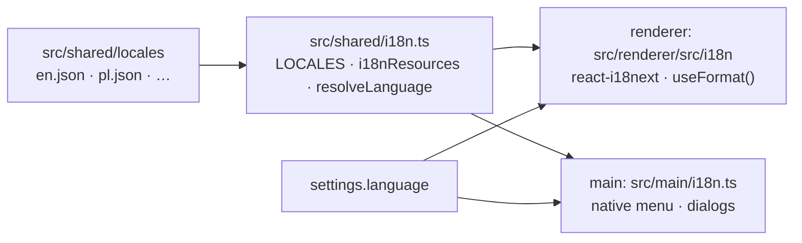

# Internationalisation

Every user-visible string — renderer UI, native menu, dialogs, error messages — comes from the
locale files in `src/shared/locales/` (`en.json`, `pl.json`, …), registered in `LOCALES` in
`src/shared/i18n.ts`. Adding a language is described in [Add a language](./howto/language).

## How it fits together

- On the first start the language comes from the system locale (`app.getLocale()` →
  `resolveLanguage`, falling back to English) and is stored in the settings.
- The renderer and the main process each run their own i18next instance with the same resources.
  When the user switches the language, the settings change is broadcast: the renderer calls
  `changeLanguage` and main rebuilds the native menu.
- Domain code in `src/core` never translates. It returns **codes** (`Issue.code`, `ModelError.code`)
  with parameters, and the UI maps them to `issues.*` and `errors.model.*` keys.

## Rules

- Never hard-code text in components. Use `const { t } = useTranslation()` and `t('area.key')`.
- Add every key to **every** locale file. `src/shared/i18n.test.ts` fails when:
  - a language has different keys than English,
  - a plural key misses a form the language needs, or has one it doesn't (from
    `Intl.PluralRules`: EN/DE `_one`, `_other`; PL/RU `_one`, `_few`, `_many`, `_other`; FR/ES/IT/PT
    also `_many`),
  - a message uses other `{{placeholders}}` than in English,
  - a message is empty or still in English (outside an allowlist of names and formats),
  - a message with `{{count}}` isn't pluralised,
  - a `t('…')` call uses a key that does not exist,
  - a key is not used anywhere in `src/` (dynamic keys are detected from template literals
    such as ``t(`sex.${value}`)``).
- Use interpolation, never string concatenation: `t('person.deleteConfirm', { name })`.
- Plurals: call `t('people.count', { count })`. Polish forms:
  `1 osoba` (one), `2–4 osoby` (few), `0, 5–21 osób` (many), `1,5 osoby` (other).
- Dates, numbers and lists: use `useFormat()` from `src/renderer/src/i18n/format.ts`
  (FuzzyDate formatting uses the date tables of `src/core/date/dateLocales.ts`, with the grammatical
  cases each language needs).
- Sorting names: `compareText(a, b, language)` from `src/core/text.ts` (Polish collation).
- Search: `foldText()` removes case and diacritics, including `ł`.

## Style guide

- Friendly, short and clear. Prefer verbs on buttons: "Add person" / "Dodaj osobę".
- English uses sentence case ("Export to CSV"), not Title Case, except in the native menu,
  which follows platform conventions.
- Polish addresses the user directly in the second person singular, informally
  ("Wybierz plik", "Twoje drzewo"), consistently everywhere.
- Ellipsis `…` (single character) marks actions that open a dialog: "Open…" / "Otwórz…".

## Glossary

| English                        | Polski                                 |
| ------------------------------ | -------------------------------------- |
| family tree                    | drzewo genealogiczne / drzewo rodzinne |
| person                         | osoba                                  |
| relative                       | krewny / krewna                        |
| parent / father / mother       | rodzic / ojciec / matka                |
| child                          | dziecko                                |
| partner / spouse               | partner(ka) / małżonek, małżonka       |
| sibling / half-sibling         | rodzeństwo / rodzeństwo przyrodnie     |
| marriage                       | małżeństwo                             |
| birth surname                  | nazwisko rodowe                        |
| given names                    | imiona                                 |
| about / before / after (dates) | ok. / przed / po                       |
| root person                    | osoba główna                           |
| ancestors / descendants        | przodkowie / potomkowie                |

## Adding a language

See the step-by-step guide [Add a language](./howto/language).
