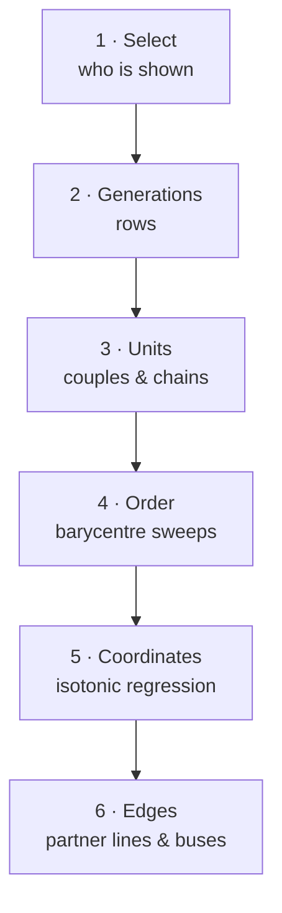

# Tree layout engine

The layout is a pure function in `src/core/layout/layout.ts`:

```ts
const layout = layoutFamily(tree, { mode, focusId, depth, collapsed, nodeWidth, nodeHeight })
// → { nodes: LayoutNode[], edges: LayoutEdge[], width, height }
```

It is deterministic (the same input always gives the same picture), has no DOM dependency and is
unit-tested on fixtures: a nuclear family, a remarriage with half-siblings, adoption, a five-generation
pedigree and 1 000 random people. The 1 000-person tree is laid out in about 30 ms; the test fails
above 200 ms locally (1 s on CI). Why a custom engine instead of a graph library is explained in the
[decision log](./reference/decisions#layout).



## 1. Select

`selectPeople(tree, options)` decides who is in the picture:

- **family** – everyone;
- **ancestors** – walk up the parent links from the focus person, `depth` levels;
- **descendants** – walk down the child links, adding the partners of the focus person and of every
  descendant (the other parents), and stop below people in `collapsed`;
- **hourglass** – both.

The canvas passes the root person as `focusId`, or the selected person when there is no root.

## 2. Generations

Rows are assigned by constraint relaxation: every child must be at least one row below each of its
parents and partners share a row. People without parents (people who married into the family) are
then pulled down to just above their highest child, so they appear next to their partner instead of
at the top of the tree.

## 3. Units

Partners in the same row form a **unit** – a couple, or a chain when someone had several partners.
A person with several partners sits in the middle, with the partners split left and right in the
order the relationships started:

<Screenshot name="remarriage" alt="Piotr Kowalski between his first wife Magdalena Nowicka and his second wife Katarzyna Kowalska, each couple's children below them" />

## 4. Order

Units in each row are ordered with **barycentre sweeps**: going down and up the rows several times,
each unit moves towards the average position of its relatives in the neighbouring row. Siblings keep
their birth order, and couples are flipped when that puts each partner on the side of their own
parents. This minimises crossing lines.

## 5. Coordinates

Alternating passes pull **children under the midpoint of their parents** and **couples above the
middle of their children**. Each pass solves one row exactly with **isotonic regression**
(the pool-adjacent-violators algorithm): it finds the positions closest to the desired ones that keep
the order from step 4 and the minimum spacing between cards. Disconnected groups are laid out side by
side with `componentGap` between them.

## 6. Edges

- **Partner edges** connect neighbours in a unit; `ended` marks finished partnerships.
- **Child edges** start in the middle of the partner line (or under a single parent), run down to a
  horizontal “bus” halfway between the rows and drop to each child. `kind` marks adoptive, step and
  foster links.

The renderer draws `ended` and non-biological edges dashed (see [Rendering](./rendering)).

## Options

| Option          | Default | Meaning                                           |
| --------------- | ------- | ------------------------------------------------- |
| `mode`          | family  | `family`, `ancestors`, `descendants`, `hourglass` |
| `focusId`       | –       | Person the non-family modes start from            |
| `depth`         | ∞       | Generations to walk in the non-family modes       |
| `collapsed`     | ∅       | People whose descendants are hidden               |
| `nodeWidth`     | 188     | Card width                                        |
| `nodeHeight`    | 68      | Card height                                       |
| `partnerGap`    | 28      | Gap between partners                              |
| `siblingGap`    | 36      | Gap between other neighbours                      |
| `generationGap` | 84      | Vertical gap between rows                         |
| `componentGap`  | 120     | Gap between disconnected groups                   |

The canvas passes its own sizes: 220 × 64 cards for **comfortable** and 172 × 48 for **compact**
density, with smaller gaps for compact cards (`SIZES` in `TreeCanvas.tsx`; exports use the same
options).

Each `LayoutNode` also reports `hasChildren` and `hasHiddenChildren`, which the card uses to show the
collapse/expand button.

## Keyboard navigation

`src/core/layout/navigation.ts` uses the finished layout: `navigate(tree, layout, id, direction)`
returns the parent (↑), a child (↓) or the nearest partner or sibling on the same row (← →) – the
nearest one on screen, so arrow keys follow what the user sees.
