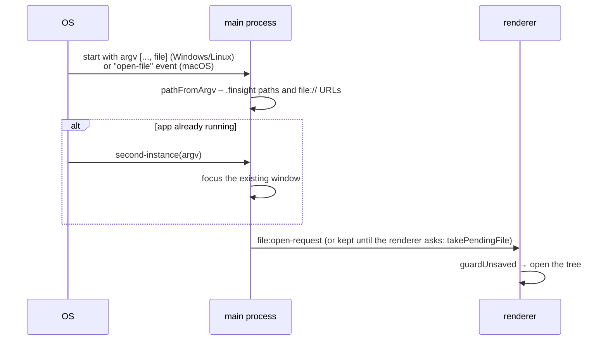

# Packaging

Installers are built by **electron-builder** from `electron-builder.yml` after `npm run build` has
bundled the app into `out/`. Only `out/**` and `package.json` are packed (source maps excluded);
`build/icon.png` is copied next to the app as the window icon.

```sh
npm run dist:dir     # unpacked app in dist/ – quick check of packaging
npm run dist:linux   # AppImage + deb
npm run dist:win     # NSIS installer + portable exe
npm run dist:mac     # DMG x64 + arm64 (macOS only)
```

Artifact names follow `family-insight-<version>-<os>-<arch>.<ext>`, with overrides for the Windows
installer (`-setup.exe`), the portable build (`-portable.exe`) and the DMG (`-mac-<arch>.dmg`).

## Targets

| OS      | Targets                     | Notes                                                                                                                                             |
| ------- | --------------------------- | ------------------------------------------------------------------------------------------------------------------------------------------------- |
| Windows | NSIS (x64), portable (x64)  | Assisted installer (`oneClick: false`), per-user (no admin), choice of folder, Start menu and desktop shortcuts, installer in English and Polish. |
| macOS   | DMG (x64 and arm64)         | Category Lifestyle, custom DMG background, **ad-hoc signed** (`identity: '-'`) so Apple Silicon runs it; hardened runtime off until notarisation. |
| Linux   | AppImage (x64), deb (amd64) | Category Office, executable `family-insight`, desktop entry with EN/PL comments and keywords; the deb declares its library dependencies.          |

The app id is `io.github.kurc.familyinsight` and the product name **Family Insight** (which is also
the name of the settings folder).

## File associations

`fileAssociations` registers `.finsight` (MIME type `application/x-family-insight`, role Editor)
in the Windows installer, the macOS app bundle and the deb package. The AppImage and the portable
exe don't register anything.

When the system opens a file with the app:



`app.requestSingleInstanceLock()` makes sure double-clicking a second file reuses the open window.
`pathFromArgv` (`src/main/argv.ts`) ignores switches such as `--no-sandbox` and accepts `file://`
URLs, which some Linux desktops pass for `%U`.

## Icons

`build/icon.svg` is the single source. `npm run icons` (`scripts/icons.mjs`) renders it with resvg into
`build/icon.png` (1024 px), `build/icons/<size>x<size>.png` for Linux, `build/icon.ico` for Windows
and `build/icon.icns` for macOS. Commit the generated files.

## Checking a build

- `npm run dist:dir` and start `dist/linux-unpacked/family-insight` (or the equivalent) to catch
  missing files.
- For Windows and macOS, run the **Release** workflow manually (`gh workflow run release.yml`) – it
  builds on real Windows and macOS runners without publishing. See [CI and releases](./ci-releases).
