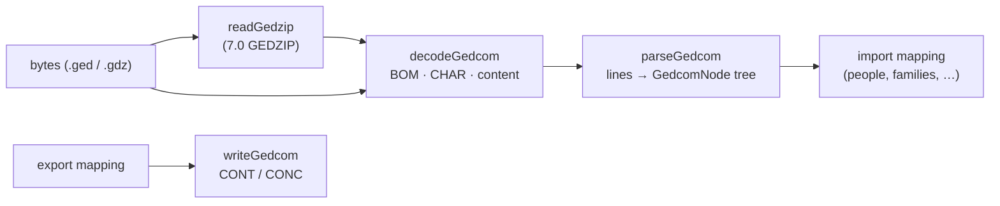

# GEDCOM

GEDCOM is the interchange format of genealogy programs. Family Insight supports **5.5, 5.5.1 and
7.0**; the code is pure TypeScript in `src/core/io/gedcom/`.

## Layers

## Line grammar – `parser.ts`

- A line is `level [@xref@] TAG [value]`; leading whitespace and CR, LF or CRLF line ends are
  accepted. `parseGedcom` builds a tree of `GedcomNode { level, xref?, tag, value?, children, line }`.
- `CONT` continues a value on a new line, `CONC` on the same line; both are folded into the parent's
  `value`, so the mapping never sees them.
- `@@` stands for `@`: everywhere in 5.5.x, only at the start of a value in 7.0. Values that are
  pointers (`@I1@`) are kept as they are.
- **Nothing throws.** Lines that don't match the grammar, level jumps (a line two levels deeper than
  its parent – attached one level below it), continuations without a parent and a missing `HEAD` or
  `TRLR` become `GedcomWarning`s with the line number.
- The version comes from `HEAD.GEDC.VERS`.
- `writeGedcom` serialises a tree: new lines become `CONT`, values longer than the line limit (255)
  are split with `CONC` – never next to a space, because some readers trim lines – and `@` is
  escaped. For 7.0, `CONC` is not used (it no longer exists) and only a leading `@` is escaped.
- Performance: 50 000 individuals (6.9 MB) parse in about 230 ms (`parser.test.ts`).

## Character sets – `encoding.ts`, `ansel.ts`

`detectGedcomEncoding` decides in this order:

1. a **byte-order mark** (UTF-8, UTF-16 LE/BE), or UTF-16 recognised by its zero bytes;
2. GEDCOM **7.0** is always UTF-8;
3. the `1 CHAR` declaration: `UTF-8`, `UNICODE` (UTF-16), `ANSEL`, `ASCII`, `ANSI`/`IBMPC`/
   `WINDOWS-1252` (Windows-1252) and `WINDOWS-1250`/`CP1250` (Central European exports) – except
   when a file declares an 8-bit set but its content is valid multi-byte UTF-8, which several
   programs do;
4. valid UTF-8 content; otherwise ANSEL (the 5.5 default).

**ANSEL** (ANSI Z39.47) is decoded by `decodeAnsel`: bytes 0xA1–0xCF are letters and symbols
(Ł, ł, Ø, Æ, ß …), 0xE0–0xFE are combining diacritics that come **before** their letter – the
decoder moves them after it and normalises to NFC, so `0xF1 0x61` becomes _ą_ and `0xE7 0x7A`
_ż_. The user can override the detected encoding in the import dialog.

## GEDZIP – `gedzip.ts`

GEDCOM 7 can be packed as a `.gdz` zip with `gedcom.ged` and the media files it references by
relative path; `readGedzip` returns both (using the container's zip reader).
