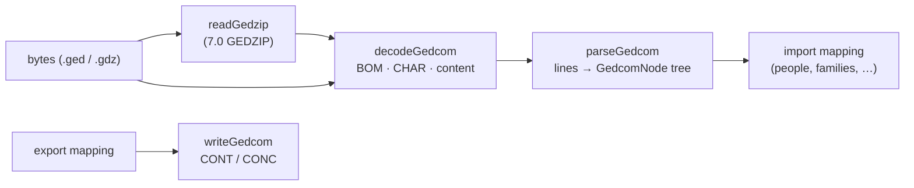

# GEDCOM

GEDCOM is the interchange format of genealogy programs. Family Insight supports **5.5, 5.5.1 and
7.0**; the code is pure TypeScript in `src/core/io/gedcom/`.

## Layers

## Line grammar – `parser.ts`

- A line is `level [@xref@] TAG [value]`; leading whitespace and CR, LF or CRLF line ends are
  accepted. `parseGedcom` builds a tree of `GedcomNode { level, xref?, tag, value?, children, line }`.
- `CONT` continues a value on a new line, `CONC` on the same line; both are folded into the parent's
  `value`, so the mapping never sees them.
- `@@` stands for `@`: everywhere in 5.5.x, only at the start of a value in 7.0. Values that are
  pointers (`@I1@`) are kept as they are.
- **Nothing throws.** Lines that don't match the grammar, level jumps (a line two levels deeper than
  its parent – attached one level below it), continuations without a parent and a missing `HEAD` or
  `TRLR` become `GedcomWarning`s with the line number.
- The version comes from `HEAD.GEDC.VERS`.
- `writeGedcom` serialises a tree: new lines become `CONT`, values longer than the line limit (255)
  are split with `CONC` – never next to a space, because some readers trim lines – and `@` is
  escaped. For 7.0, `CONC` is not used (it no longer exists) and only a leading `@` is escaped.
- Performance: 50 000 individuals (6.9 MB) parse in about 230 ms (`parser.test.ts`).

## Character sets – `encoding.ts`, `ansel.ts`

`detectGedcomEncoding` decides in this order:

1. a **byte-order mark** (UTF-8, UTF-16 LE/BE), or UTF-16 recognised by its zero bytes;
2. GEDCOM **7.0** is always UTF-8;
3. the `1 CHAR` declaration: `UTF-8`, `UNICODE` (UTF-16), `ANSEL`, `ASCII`, `ANSI`/`IBMPC`/
   `WINDOWS-1252` (Windows-1252) and `WINDOWS-1250`/`CP1250` (Central European exports) – except
   when a file declares an 8-bit set but its content is valid multi-byte UTF-8, which several
   programs do;
4. valid UTF-8 content; otherwise ANSEL (the 5.5 default).

**ANSEL** (ANSI Z39.47) is decoded by `decodeAnsel`: bytes 0xA1–0xCF are letters and symbols
(Ł, ł, Ø, Æ, ß …), 0xE0–0xFE are combining diacritics that come **before** their letter – the
decoder moves them after it and normalises to NFC, so `0xF1 0x61` becomes _ą_ and `0xE7 0x7A`
_ż_. The user can override the detected encoding in the import dialog.

## GEDZIP – `gedzip.ts`

GEDCOM 7 can be packed as a `.gdz` zip with `gedcom.ged` and the media files it references by
relative path; `readGedzip` returns both (using the container's zip reader).

## Import mapping – `import.ts`, `dates.ts`

`importGedcom(document)` turns the record tree into a `FamilyTree` plus a summary (people, families,
events, sources, media, the exporting program, unsupported tags grouped as `INDI._APID: 12`) and
warnings. Nothing is fatal.

| GEDCOM                                                                                                                 | Family Insight                                                                                                                                 |
| ---------------------------------------------------------------------------------------------------------------------- | ---------------------------------------------------------------------------------------------------------------------------------------------- |
| `INDI.NAME` `Given /Surname/`, `GIVN`, `SURN`                                                                          | `givenNames`, `surname`                                                                                                                        |
| second `NAME` with `TYPE married`, or `_MARNM`                                                                         | `surname` = married name, `birthSurname` = the birth name                                                                                      |
| `SEX` `M`/`F`/`X`/`U`                                                                                                  | `sex` male/female/other/unknown                                                                                                                |
| `BIRT`, `DEAT` (`DEAT Y` = deceased) with `DATE`, `PLAC`, `SOUR`                                                       | `birth`, `death`, `living: false`                                                                                                              |
| `BAPM` `CHR` `CONF` `FCOM` `BURI` `CREM` `EMIG` `IMMI` `NATU` `RESI` `OCCU` `EDUC` `GRAD` `RELI` `CENS` `RETI` `_MILT` | life events; the value (e.g. the occupation) becomes the description                                                                           |
| `EVEN`/`FACT` with `TYPE`                                                                                              | a built-in event when the type matches (military service, award), otherwise a custom event named by `TYPE`                                     |
| `NOTE` (inline, `@N@` records), `SNOTE` (7.0)                                                                          | `notes`                                                                                                                                        |
| `SOUR @S@` with `PAGE`, `QUAY` 0–3, `DATA.TEXT`, `DATA.DATE`, `NOTE`                                                   | citations next to the fact (`QUAY` 3 primary, 2 secondary, 1 questionable, 0 unreliable); inline `SOUR text` creates a source with that title  |
| `SOUR` record: `TITL`, `AUTH`, `PUBL`, `REPO @R@` + `CALN`, `NOTE`, `TEXT`                                             | source                                                                                                                                         |
| `REPO`: `NAME`, `ADDR`, `WWW`, `NOTE`                                                                                  | repository                                                                                                                                     |
| `OBJE` (inline or record) with `FILE`, `TITL`                                                                          | a media reference for the caller to load (`attachMedia`); the people or sources referencing it get it in their gallery                         |
| `PLAC` with `MAP.LATI`/`LONG` (`N50.06`, `E19.94`)                                                                     | place text + gazetteer coordinates                                                                                                             |
| `FAM` `HUSB`/`WIFE`                                                                                                    | partnership: `MARR` → marriage (start), only `ENGA` → engagement, otherwise partnership; `DIV` → end reason divorce, `ANUL` → end reason other |
| `FAM.CHIL` + `INDI.FAMC.PEDI` birth/adopted/foster/sealing, or `CHIL._FREL`/`_MREL` (Ancestry)                         | parent–child links: biological/adoptive/foster (sealing → biological), `Step` → step                                                           |

**Dates** (`parseGedcomDate`): `4 NOV 1925`, `NOV 1925`, `1925` → exact; `ABT`/`CAL`/`EST` →
about; `BEF`/`AFT` → before/after; `FROM … TO …` → start and end (lossless for life events);
`BET … AND …` → after the first and before the second date. Approximations are reported as
**lossy** and the original text is kept in the person's notes (`GEDCOM: BIRT: @#DJULIAN@ 12 MAR
1702`): dual years (`1700/01` → 1700), other calendars (`@#DJULIAN@`, kept as written), `INT …
(phrase)`, phrases without a date, open periods (`FROM 1914`). Birth and death hold one date, so a
range there keeps its start.

**Integrity:** references to records that don't exist are warnings (`gedcom-dangling-reference`
with the xref); a child with more than two biological parents keeps the first two, the others
become step-parents (`gedcom-extra-parents`); a link closing an ancestry cycle is dropped
(`gedcom-ancestry-cycle`). The result always passes `validateTree`.

**Fixtures** in `src/core/io/gedcom/fixtures/` are synthetic files in the style of Gramps,
Ancestry, MyHeritage, FamilySearch and GEDCOM 7 exports (plus an ANSEL file built in the test) –
no real people's data.

## Export – `export.ts`

`exportGedcom(tree, options)` writes **5.5.1** (UTF-8, the default – most programs read it) or
**7.0**, and returns the media files the text references (`media/<file name>`), so the caller can
copy them next to the `.ged` file or pack a GEDZIP (`writeGedzip`). Cross-references are numbered in
tree order (`@I1@`, `@F1@`, `@S1@`, `@R1@`, `@O1@`), so the same tree always gives the same file.

- `HEAD` with `GEDC.VERS`, `SOUR FAMILY_INSIGHT`, `DATE`, `CHAR UTF-8` (5.5.1) and a `SUBM` record;
  `TRLR` at the end. Dates use English month names whatever the UI language.
- A person with a birth surname gets two names: the birth name first, then the current one with
  `TYPE married` – the import reads it back the same way.
- Life events use their standard tag; military service, awards and custom events become
  `EVEN` + `TYPE`. The description is the value of attributes (`OCCU`, `EDUC`, `RELI`) and `EVEN`,
  and the `TYPE` of other events. A period is `DATE FROM … TO …`.
- Families: every partnership is a `FAM`; children whose parents aren't partners get a `FAM` of
  their parents. A child's pedigree is `FAMC.PEDI` when both parents have the same kind, otherwise
  `_FREL`/`_MREL` on `CHIL` (as Ancestry writes it); step-parents always use `_FREL`/`_MREL`.
- The portrait is an `OBJE` link with `_PRIM Y`; gallery items are plain `OBJE` links to media
  records (`FILE` + `FORM`, `TITL`, the description as `NOTE`).
- Coordinates from the gazetteer are written as `PLAC.MAP.LATI`/`LONG`.
- `privatizeLiving` replaces people who may be alive (not marked deceased, no death, born less than
  110 years ago or without a birth date) with "Living" and leaves out everything but their sex and
  family links – the usual practice when sharing trees.

### What a round trip keeps and loses

`export.test.ts` exports the sample family with events, sources, citations, media, coordinates,
step and adoptive links, and a partnership that ended, re-imports it, and compares everything
(for both versions, and for a random tree of 400 people). Intentionally lossy:

| Field                                                                                | In GEDCOM                                                                                                                            |
| ------------------------------------------------------------------------------------ | ------------------------------------------------------------------------------------------------------------------------------------ |
| `living: true`                                                                       | GEDCOM only records death, so "alive" becomes unknown.                                                                               |
| Source URL                                                                           | a `URL: …` line in the source's note.                                                                                                |
| Partnership kinds other than marriage and engagement, end reasons other than divorce | `FAM.EVEN` with `TYPE Partnership` / `End: separation` – Family Insight reads them back; other programs show a generic family event. |
| Qualifiers of a period's dates                                                       | `FROM … TO …` dates are exact.                                                                                                       |
| Media file bytes                                                                     | not in the text: in a `media/` folder next to the file (5.5.1) or inside a GEDZIP (7.0).                                             |
| View settings, root person                                                           | not exported (the first person becomes the root on import).                                                                          |

Sample exports of the sample family are in `docs/public/samples/` (`sample-family-5.5.1.ged`,
`sample-family-7.0.ged`); `samples.test.ts` re-imports them and regenerates them with
`UPDATE_GEDCOM_SAMPLES=1`. No external GEDCOM validator was available offline; the files were
checked by re-importing them and against the specification.

## In the app

- The format is registered as `gedcom` (`.ged`, `.gdz`) in `registerBuiltInFormats`, so file
  dialogs and main accept the extensions; GEDZIP export uses the extra save filter `gedzip`.
  `.ged` files are associated with the app as a _Viewer_ (they open the import, not as the native
  format); argv, double-click and drag-and-drop all go to `startGedcomImport`.
- For `.ged`/`.gdz`, main returns the **raw bytes** (`FileReadResult.bytes`). The import dialog
  (`features/gedcom/ImportGedcomDialog.tsx`) unzips a GEDZIP, decodes (detected or chosen
  encoding), parses and maps in the renderer, and shows the version, the program, counts, line
  warnings, mapping warnings and the grouped unsupported tags. Importing as a new tree or merging
  (one undoable `mergeTreeCommand`) both load the referenced media first:
  - from the GEDZIP (`putMedia`), or
  - by path through main (`importMediaFromPaths`): as written, else the same name next to the
    `.ged` or in its `media` folder;
  - then `prepareMediaFiles` makes thumbnails and `attachMedia` links the items; files that
    weren't found are counted in a toast.
- The export dialog (`ExportGedcomDialog.tsx`) runs `exportGedcom` in the renderer and hands the
  text and the list of media to main (`exportGedcom` IPC), which writes the `.ged` plus a `media`
  folder, or one `.gdz`.
- e2e: `e2e/gedcom.spec.ts` imports a fixture, exports 7.0, re-imports with the same counts, and
  opens a damaged file without a crash.
