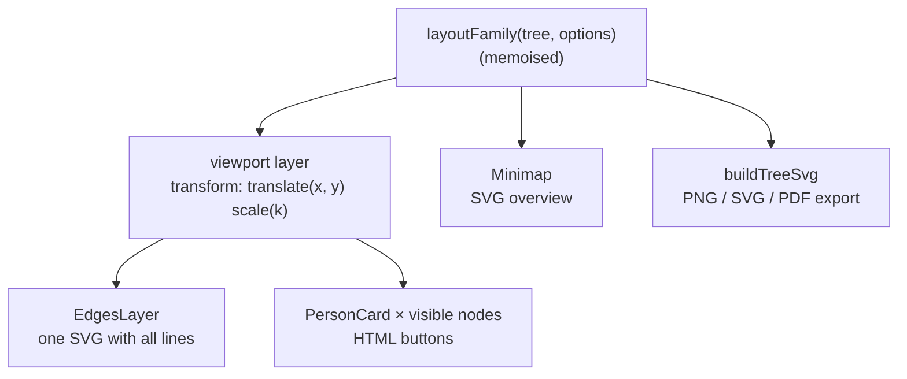

# Rendering the tree

The tree is drawn by `src/renderer/src/features/tree/TreeCanvas.tsx` from the
[layout](./layout). It uses plain DOM and SVG – no canvas element and no graph library.

## Canvas, cards and edges

- One absolutely positioned **viewport layer** holds everything; panning and zooming only change its
  CSS `transform`, so the browser moves a single composited layer.
- **Edges** are one SVG (`EdgesLayer.tsx`) with a path per layout edge. Ended partnerships and
  adoptive, step and foster links get a dashed style.
- The **selected or hovered person's lines** stand out in the accent colour and the other lines step
  back to 45 % opacity. Each edge lists everyone it connects (`people`: both partners, or the
  parents and the child), so a couple's line lights up for either parent. The colour and opacity
  change is a short transition, switched off with `prefers-reduced-motion`. A highlighted
  relationship path takes precedence.
- **Cards** (`PersonCard.tsx`) are `<button>`s with the avatar (photo or initials), name, birth
  surname and lifespan, a colour accent by sex and markers for the root person and deceased people.
  States: hover, selected, search match and dimmed. Compact density uses a smaller card.
- In the **Tapestry style** (`data-style="tapestry"`) the card CSS turns comfortable cards into
  upright medallions with a gold double frame (portrait above the name; compact cards keep the row),
  and `EdgesLayer` gets `tapestry`: corners round with a 24 px radius, solid lines get a thin
  sheen on the gold thread and neighbouring partners a small knot. Card sizes per style and
  density come from `cardSizes()` in `TreeCanvas.tsx`, so the layout engine needs no special case.
- Only cards inside the visible area (plus a 300 px margin) are rendered, which keeps 1 000-person
  trees smooth.
- Layout changes (view mode, collapsing, new people) animate with CSS transitions; with
  `prefers-reduced-motion: reduce` the transitions are switched off.

## Pan and zoom

`src/renderer/src/store/treeView.ts` keeps the viewport `{ x, y, k }` (zoom limited to 15 %–250 %)
and helpers: `fitViewport` (fit the whole layout, never above 100 %), `centerViewport` and
`zoomViewport` (zoom around a point). The canvas handles:

- pointer drag on the background → pan (with pointer capture);
- wheel → zoom around the cursor; pinch gestures arrive as `ctrlKey` wheel events and zoom faster;
- selection changes → scroll the selected card into view if it's off-screen;
- the viewport is remembered per document while the app runs and the first view of a document is
  fitted after the canvas has measured itself.

## Overview map

`Minimap.tsx` draws every node as a small rectangle in an SVG scaled to fit, with a frame for the
visible area. Clicking or dragging in it moves the viewport. It can be hidden from the zoom controls
or the **View** menu (`showMinimap` setting).

## Accessibility

- The canvas has `role="application"`, a label (“Family tree”) and an `aria-roledescription` that
  explains the arrow keys; a **skip link** jumps to it.
- Arrow keys move between relatives (`navigate`, see [layout](./layout#keyboard-navigation)), focus
  follows the selected card, and a polite live region announces the person with their parents,
  partners and children (`a11y.*` strings).
- Every card has an accessible name (name, lifespan, birth surname); the collapse buttons are named
  “Hide/Show descendants of …”.
- `e2e/a11y.spec.ts` runs axe-core on the app in both themes.

## Export

`src/renderer/src/features/export/treeSvg.ts` builds a standalone SVG from the same layout (always in
the light palette, optionally with a title), measuring text the way the canvas does. PNG export
rasterises that SVG in the renderer; PDF export and printing send it to main, which renders it in a
hidden, sandboxed window without JavaScript and calls `printToPDF` or `print`.
