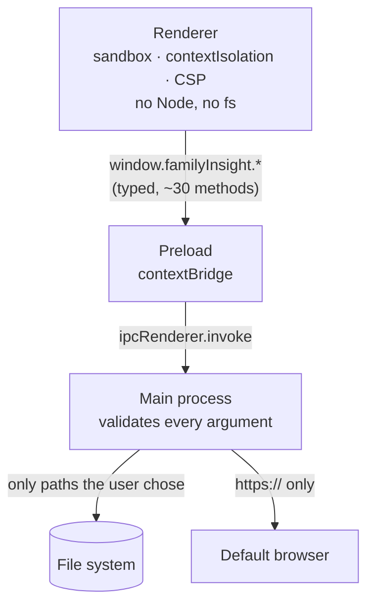

# Security model

A family tree contains personal data, and the app opens files that may come from anyone (a CSV from a
relative, a `.finsight` from the internet). The design assumes that the renderer could be tricked
into running hostile code and limits what it could do.

## The renderer is a sandboxed web page

The window is created in `src/main/index.ts` with:

| Setting            | Value   | Effect                                                    |
| ------------------ | ------- | --------------------------------------------------------- |
| `contextIsolation` | `true`  | The page can't reach the preload's or Electron's objects. |
| `nodeIntegration`  | `false` | No `require`, no Node APIs in the page.                   |
| `sandbox`          | `true`  | The renderer runs in Chromium's OS-level sandbox.         |

`src/renderer/index.html` sets a strict **Content Security Policy**:
`default-src 'self'; script-src 'self'; style-src 'self' 'unsafe-inline'; img-src 'self' data: blob:; font-src 'self' data:`.
No remote scripts, no `eval`, no network requests to other origins. Photos are shown from `blob:`
object URLs of their thumbnails, and the crop dialog and exports use `data:` URLs, which is why both
are allowed for images. PDFs are shown in Chromium's PDF viewer in an `<iframe>` of a `blob:` URL
(`frame-src blob:`); nothing else may be framed.

Navigation is locked down too: `will-navigate` cancels any attempt to load another page, and
`setWindowOpenHandler` denies new windows – `https://` links are handed to the default browser with
`shell.openExternal`, everything else is dropped.

## The preload API

`src/preload/index.ts` exposes exactly one object, `window.familyInsight`, typed by
`FamilyInsightApi` in `src/shared/ipc.ts`. It only forwards calls with `ipcRenderer.invoke` and
subscribes to a few events; it contains no logic and never exposes `ipcRenderer` itself. The full
list of methods is in the [Preload API reference](./reference/preload-api).

## Validation in main

Every `ipcMain.handle` treats its arguments as `unknown` and checks them before use. Examples:

- **settings** – `updateSettings(patch)` runs the patch through `sanitizeSettings`
  (`src/core/settings.ts`), which keeps only known keys with valid values;
- **menu state** – booleans must be `true` to count, the view mode must be one of the four modes;
- **recovery snapshots** – the id must match `/^[a-zA-Z0-9-]{1,64}$/`, so it can't escape the recovery
  folder; names are truncated;
- **printing and PDF** – the content must be SVG markup; it is rendered in a separate hidden window
  with `sandbox: true` and `javascript: false`.

## File access rules

The renderer never sees the file system. `src/main/files.ts` enforces:

- **Writable paths** are only those the user picked in a save dialog or opened in this session
  (`writable` set). `writeFile` to any other path fails with `permission` – even a compromised
  renderer can't overwrite arbitrary files.
- **Readable files** must have the extension of a registered format (`.finsight`, `.csv`), and are
  limited to 200 MB (`.finsight` containers to 2 GiB); photos are picked through their own dialog
  and limited to 20 MB.
- **Media files** enter a library only after main has checked their type by magic bytes (JPEG,
  PNG, WebP, GIF, PDF – never by extension) and size (25 MB). Container entries are only accepted
  under `media/<sha256>.<ext>` and `thumbs/<sha256>.webp`; other names (including `../` paths) are
  ignored, and nothing is ever extracted to disk – except a temporary copy when the user opens a
  file in another app (`openMediaExternally`), whose extension follows the detected type (a
  disguised executable can't be launched that way).
- Writes are **atomic** (temporary file, then rename), so a crash never leaves a half-written tree.
- Backups and recovery copies are written only by main, to fixed locations.

## External content

- `.finsight` files are parsed with `parseTree` (`src/core/file`), which validates the structure and
  migrates old versions; files from a newer version are refused instead of being misread.
- CSV files are parsed by the pure importer, which never executes anything and reports problems
  instead of throwing.
- The app makes **no network requests** of its own. There is no telemetry and no auto-update yet.
  The one exception is the opt-in **place lookup**: off by default (`onlinePlaceLookup`), asked for
  with an explanation on first use, and only on an explicit click. Main (`src/main/geocoder.ts`)
  sends the single place name to OpenStreetMap Nominatim – at most one request per second, an
  identifying User-Agent, answers cached in `userData/place-lookup-cache.json`. The renderer never
  talks to the network; the CSP is unchanged.

## When you add a feature

- Add new OS capabilities as narrow IPC methods (`saveCsv(content)` rather than `writeAnyFile(path)`),
  following [Add an IPC channel](./howto/ipc).
- Validate every argument in main; never trust types from the renderer.
- Never relax `contextIsolation`, `sandbox` or the CSP. If you think you need to, open an issue first.
