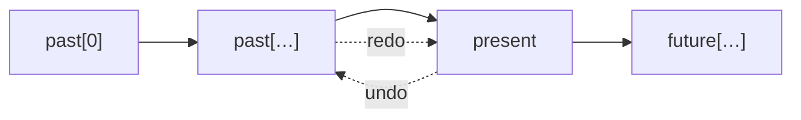
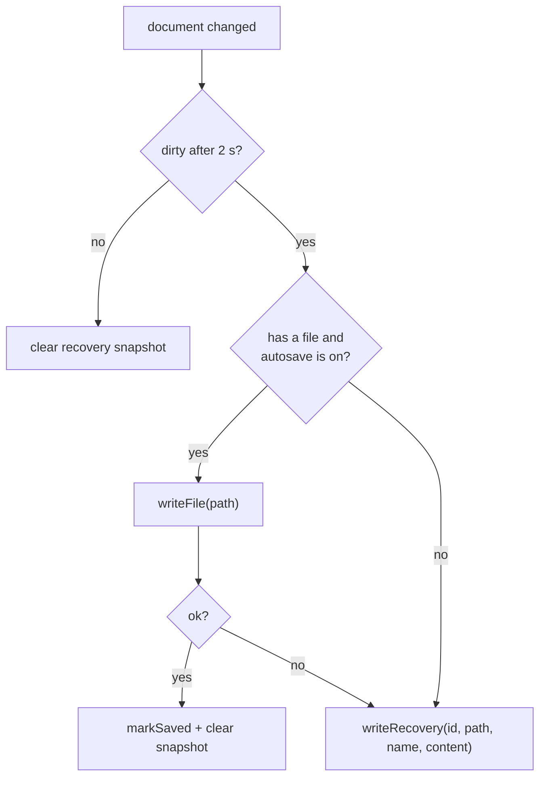

# State, undo and saving

## Stores

The renderer keeps its state in four small [Zustand](https://zustand.docs.pmnd.rs/) stores in
`src/renderer/src/store`:

| Store            | Holds                                                                                                                                 |
| ---------------- | ------------------------------------------------------------------------------------------------------------------------------------- |
| `useDocument`    | The open tree (`history.present`), its `history`, `filePath`, `savedTree` (last saved version), selection and a `documentId` counter. |
| `useSettings`    | A mirror of the settings kept by main; `update(patch)` sends changes over IPC.                                                        |
| `useTreeView`    | Viewport (pan/zoom), view mode, depth, collapsed branches, canvas size.                                                               |
| `useWorkspaceUi` | Search query, list sorting, the person being edited and open dialogs.                                                                 |

Components subscribe to the slices they need (`useDocument((s) => s.selectedPersonId)`), so a change
only re-renders what depends on it.

## Commands

Every change to the document is a **command** (`src/renderer/src/store/commands.ts`):

```ts
export interface Command<R = void> {
  label: string // i18n key, e.g. 'history.addPerson'
  coalesceKey?: string // merge rapid edits of the same field into one undo step
  run: (tree: FamilyTree) => { tree: FamilyTree; result: R; select?: PersonId | null }
}
```

`useDocument.getState().dispatch(command)` runs it against the current tree, pushes the result onto
the history and applies the requested selection. `composeCommands(label, build)` combines several
commands into **one** undo step – “add father” is “add person” + “add parent link” + maybe “add
partnership”:

```ts
runCommand(
  composeCommands('relations.add.father', (initial, run) => {
    const parent = run(addPersonCommand({ givenNames: '', surname, sex: 'male' }))
    run(addParentChildCommand(parent.id, person.id))
    return parent.id
  })
)
```

`runCommand` (in `features/person/relationActions.ts`) turns a `ModelError` into a translated toast.

## History

`src/core/history.ts` is a generic, snapshot-based undo stack:



- Snapshots are cheap because trees are immutable and share unchanged objects.
- `pushHistory` clears `future`, keeps at most `HISTORY_LIMIT` (200) entries and **coalesces**
  consecutive changes with the same `coalesceKey` within 1.5 s – typing in one field becomes one
  undo step. Field edits use `<personId>:<fields>` as the key, renaming the tree uses `meta.name`.
- Loading or creating a document starts a fresh history; saving doesn't touch it.
- The view (mode, depth, collapsed branches) is not part of the history.

## Dirty state and saving

`selectIsDirty` compares `history.present` with `savedTree` by identity, so undoing back to the saved
version makes the document clean again. Saving (`services/documentFiles.ts`):

1. `treeForSave(tree)` adds the current view settings to `meta.view`;
2. `serializeTree` produces the JSON;
3. `window.familyInsight.writeFile(path, content, { backup: true })` – main rotates `.bak1…5` and
   writes atomically;
4. `markSaved(path, tree)` records the saved version and the file path.

Opening a file goes the other way: `readFile` → `parseTree` (validate + migrate) → `loadDocument` →
`applyViewMeta`.

## Autosave and crash recovery

`useAutosave` (`services/autosave.ts`) subscribes to the document store. **2 seconds after the last
change** of a dirty document:



Recovery snapshots are JSON files in `userData/recovery/<id>.json`, one per open document session.
They are removed when the document is saved, discarded or closed normally. At start-up,
`listRecoverable` (main) returns snapshots that are newer than their original file; the renderer
shows the recovery dialog for them. Autosave never creates backup copies – only explicit saves do.

## Unsaved-changes guard

`guardUnsaved()` asks main to show the native **Save / Don't save / Cancel** dialog before anything
replaces the open document (new tree, open, import into a new tree, sample family). Closing the
window goes through the same question: main sends `window:close-request`, the renderer decides and
calls `closeWindow()`.
